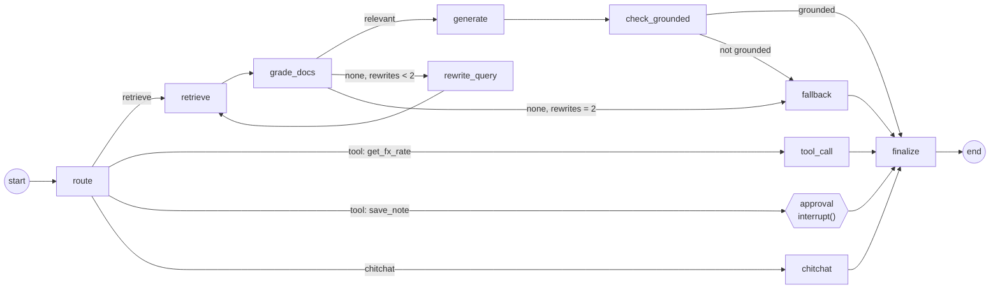

# agentic-rag-platform

On-prem-capable **agentic RAG** reference platform: a FastAPI gateway in front
of a LangGraph agent, MCP tools, hybrid retrieval (pgvector + Qdrant +
reranker), local inference (vLLM / NVIDIA NIM), Langfuse tracing, evals in CI,
and a Helm chart.

This repo is the portfolio project for a Senior AI Platform Engineer
(Generative & Agentic AI) role. The rule is simple: **claim only what you can
demo**. The 20-day roadmap below is the build plan; Days 1–4 are what runs today.

Default LLM provider is **xAI Grok** via the official [`xai-sdk`](https://pypi.org/project/xai-sdk/)
(`grok-4.7`). OpenAI and Anthropic adapters are included so their tool-calling
and structured-output APIs can be learned and compared — see
[docs/learning-notes.md](docs/learning-notes.md).

## What works today (Days 1–4 + OpenTelemetry lab)

- FastAPI app with `GET /health`, `POST /chat` (LangGraph agent), `POST /chat/stream`
  (SSE), `POST /chat/resume`, `POST /chat/loop` (Day 1 loop), `POST /ingest`, `POST /search`
- Provider interface (`Protocol`) with **xAI as default**, plus OpenAI and
  Anthropic official-SDK adapters, selected by `LLM_PROVIDER`
- Tool-calling loop with a `get_fx_rate(base, quote)` tool (NBP API, Frankfurter
  fallback, timeouts, structured errors)
- Structured output `Answer{answer, citations, confidence}` validated with Pydantic
- Settings via `pydantic-settings`, `.env` / `.env.example`
- Day 2 ingestion: pypdf → structure-aware chunker (512–800 tokens, ~12%
  overlap, section metadata, content hash) → embeddings → Postgres + pgvector
  with an HNSW index (`vector_cosine_ops`, `m=16`, `ef_construction=64`)
- Default embedder is the local multilingual model
  `intfloat/multilingual-e5-base` (e5 `query:` / `passage:` prefixes,
  L2-normalised). `BAAI/bge-m3` is an option; OpenAI
  `text-embedding-3-small` is used only when `OPENAI_API_KEY` is set.
- OpenTelemetry traces for `/chat`, `/ingest` and `/search`: FastAPI, psycopg
  and httpx auto-instrumentation, plus manual GenAI spans (`invoke_agent`,
  `chat`, `execute_tool`, `embeddings`, `retrieval`). Off until you set
  `OTEL_EXPORTER_OTLP_ENDPOINT` or `OTEL_TRACES_EXPORTER=console`. See
  [docs/otel-notes.md](docs/otel-notes.md).
- `docker-compose` (api + Postgres/pgvector + Qdrant; `otel` profile for Collector + Jaeger;
  Langfuse stub commented for Day 6)
- Multi-stage, non-root `Dockerfile` built with `uv`
- pre-commit (ruff, mypy), pytest, GitHub Actions CI (no real API calls;
  integration tests that need Postgres are skipped unless `DATABASE_URL` is set)
- `make smoke` — optional live call to xAI when `XAI_API_KEY` is set
- `make db-init`, `make ingest`, `make bench` — schema, corpus ingest, HNSW vs
  exact-search numbers in [docs/retrieval-notes.md](docs/retrieval-notes.md)
- Day 3 retrieval: `dense | sparse | hybrid | hybrid_rerank` on **pgvector**
  (Postgres full-text + pgvector fused with RRF in one SQL query) or **Qdrant**
  (dense + BM25 sparse vectors in one collection, Query API prefetch + RRF/DBSF),
  plus a cross-encoder reranker (top 50 → top k). Chosen by
  `RETRIEVAL_STRATEGY` / `RETRIEVAL_BACKEND` or per `/search` request.
- `make eval` — 50 labelled questions, hit@5 / recall@5 / MRR@10 per strategy
  and backend ([docs/eval-results.md](docs/eval-results.md))
- Day 4 LangGraph agent: `route → retrieve → grade_docs → rewrite_query (max 2) →
  generate (with [n] citations) → check_grounded`, plus an FX tool branch, a
  chit-chat branch and a human-approval `interrupt()` before a write tool.
  Postgres checkpointer (`thread_id` = conversation memory), SSE streaming of
  node events and tokens, loop/cost guards, OTel spans per node. A Pydantic AI
  version of retrieve → answer and a framework comparison in
  [docs/frameworks.md](docs/frameworks.md).

## Planned architecture


Days 1–2 are the **LLM gateway** plus the **ingestion / pgvector** slice.
The weekend OpenTelemetry lab adds vendor-neutral traces. Hybrid search, MCP,
Langfuse (as an OTLP backend), evals, local inference and Kubernetes land on
later days.

## Quickstart

Requirements: Python 3.12 and [uv](https://docs.astral.sh/uv/). An
[xAI API key](https://console.x.ai/) for live calls.

```bash
git clone https://github.com/saequus/agentic-rag-platform.git
cd agentic-rag-platform
uv sync --dev
cp .env.example .env
# edit .env and set XAI_API_KEY=...

uv run fastapi dev src/agentic_rag_platform/main.py --port 8000
```

Health check and a chat turn with the Day 1 tool loop (the LangGraph agent
at `POST /chat` is described in [Day 4](#day-4-langgraph-agent)):

```bash
curl -s http://127.0.0.1:8000/health | jq

curl -s http://127.0.0.1:8000/chat/loop \
  -H 'content-type: application/json' \
  -d '{"message":"What is the mid rate of 1 USD in PLN today? Cite your source."}' | jq
```

Example response shape:

```json
{
  "answer": "1 USD is 4.25 PLN at the NBP mid rate published on 2026-11-19.",
  "citations": ["https://api.nbp.pl/api/exchangerates/rates/a/usd/?format=json"],
  "confidence": 0.93,
  "provider": "xai",
  "model": "grok-4.7",
  "tool_calls": [
    {
      "id": "call_1",
      "name": "get_fx_rate",
      "arguments": {"base": "USD", "quote": "PLN"},
      "result": "{\"base\": \"USD\", \"quote\": \"PLN\", \"rate\": 4.25, \"source\": \"NBP\"}"
    }
  ]
}
```

### Postman

A Collection v2.1 and a `local` environment live in [`postman/`](postman/). In the Postman desktop app: **Import** → choose the files `postman/agentic-rag-platform.postman_collection.json` and `postman/local.postman_environment.json`, then select the **local** environment in the top-right corner (`baseUrl=http://localhost:8000`). Interactive docs are at [http://localhost:8000/docs](http://localhost:8000/docs) (`/openapi.json` for the schema). Do not send **Ingest corpus** unless you want a full re-embed; use **Ingest a single PDF** for a quick check.

### Docker Compose

```bash
cp .env.example .env   # set XAI_API_KEY
docker compose up --build
curl -s http://127.0.0.1:8000/health
```

Postgres with pgvector is included for ingestion. After the first
`docker compose up`, run `make db-init-docker`. It applies every migration
inside the API container against `postgres:5432`. Don't run `make db-init`
against `localhost:5432` for the container database: if Postgres.app is also
running on the Mac, it owns port 5432 and the migration lands there instead.
That is the "column c.content_tsv does not exist" error. A Langfuse service is left commented in `docker-compose.yml` (Day 6).
OpenTelemetry Collector + Jaeger are available with `--profile otel`
(see [docs/otel-notes.md](docs/otel-notes.md)).

### OpenTelemetry (optional)

```bash
make otel-up
export OTEL_EXPORTER_OTLP_ENDPOINT=http://127.0.0.1:4318
uv run fastapi dev src/agentic_rag_platform/main.py --port 8000
# send a /chat or /search request, then open http://127.0.0.1:16686
```

Without Docker, `OTEL_TRACES_EXPORTER=console` prints spans to stdout.
Details and the GenAI attribute map: [docs/otel-notes.md](docs/otel-notes.md).

### Tests and live smoke

```bash
make lint          # ruff + mypy
make test          # unit tests, all HTTP/LLM calls mocked
make smoke         # real xAI call; requires XAI_API_KEY; not run in CI
```

Integration tests for pgvector run only when `DATABASE_URL` is set
(`pytest -m integration`). CI does not set it, so those tests are skipped.

### Day 2: ingest and search (local Postgres.app)

The default `DATABASE_URL` in `.env.example` is
`postgresql://slava@localhost:5432/agentic_rag` — the database already
created on the development Mac (Postgres.app 18, trust auth, pgvector
0.8.7 enabled). From a fresh clone:

```bash
git pull
uv sync --dev
cp .env.example .env          # already points at agentic_rag; add XAI_API_KEY if you want /chat
make db-init                  # extension, tables, HNSW index
make ingest                   # downloads 23 public PDFs into data/raw (gitignored), then embeds
make bench                    # 50 queries, HNSW vs exact search, updates docs/retrieval-notes.md
```

The first `make ingest` also downloads `intfloat/multilingual-e5-base`
(~1 GB) from Hugging Face. To compare with OpenAI embeddings, set
`EMBEDDING_PROVIDER=openai` and `OPENAI_API_KEY`, then re-run
`make db-init` against an empty database (the vector dimension is 1536
instead of 768) and `make ingest` again.

Search via the API (after `make dev` or `uv run fastapi dev ...`):

```bash
curl -s http://127.0.0.1:8000/search \
  -H 'content-type: application/json' \
  -d '{"query":"ECB interest rate decision and the 2% inflation target","k":5}' | jq
```

The committed corpus is 12 ECB Economic Bulletins and 11 official Polish
retail Treasury bond issue letters. NBP inflation reports are documented
in [docs/retrieval-notes.md](docs/retrieval-notes.md) but are not in
`data/urls.txt`, because nbp.pl served a bot challenge from the network
used to verify the URLs.

### Day 3: hybrid search, Qdrant, reranking

```bash
git pull && uv sync --dev
make db-init        # adds migration 002: generated tsvector column + GIN index (keeps your data)
make test

# Qdrant, pick one:
make qdrant-up && export QDRANT_URL=http://127.0.0.1:6333    # Docker
# or the native binary (no Docker), macOS arm64:
#   curl -L https://github.com/qdrant/qdrant/releases/download/v1.20.2/qdrant-aarch64-apple-darwin.tar.gz | tar xz
#   ./qdrant &          # then: export QDRANT_URL=http://127.0.0.1:6333
# or leave QDRANT_URL unset: embedded mode in data/qdrant (no server, brute force,
# one process at a time, so stop the API before running make eval)

make qdrant-sync    # copies chunks + their e5 vectors from Postgres into Qdrant
make eval           # ~2 min on CPU; writes docs/eval-results.md and data/eval/results.json
make eval EVAL_BACKENDS=pgvector   # if you skip Qdrant
```

The first `hybrid_rerank` request downloads `cross-encoder/ms-marco-MiniLM-L-6-v2`
(~90 MB). `RERANK_MODEL=BAAI/bge-reranker-v2-m3` is multilingual and scored
better, but takes ~8–10 s per query on CPU.

```bash
curl -s http://127.0.0.1:8000/search -H 'content-type: application/json' -d '{
  "query": "Jakie jest oprocentowanie obligacji EDO1136 w pierwszym okresie odsetkowym?",
  "k": 5, "strategy": "hybrid_rerank", "backend": "qdrant"}' | jq '.timings_ms, .hits[].doc_id'
```

Results (50 questions, e5-base, CPU; full table and method in
[docs/retrieval-notes.md](docs/retrieval-notes.md#day-3-hybrid-search-qdrant-reranking)):

| backend | strategy | hit@5 | recall@5 | MRR@10 | search p50 |
|---|---|---|---|---|---|
| pgvector | dense | 0.40 | 0.33 | 0.32 | 11.9 ms |
| pgvector | sparse | 0.58 | 0.51 | 0.46 | 27.5 ms |
| pgvector | hybrid | 0.64 | 0.58 | 0.50 | 23.0 ms |
| pgvector | hybrid_rerank | 0.70 | 0.64 | 0.57 | 31.4 ms |
| qdrant | dense | 0.54 | 0.44 | 0.41 | 8.2 ms |
| qdrant | sparse | 0.56 | 0.50 | 0.47 | 7.8 ms |
| qdrant | hybrid | 0.64 | 0.55 | 0.47 | 14.8 ms |
| qdrant | hybrid_rerank | 0.68 | 0.62 | 0.56 | 16.6 ms |

CI on `main` and on pull requests runs ruff, mypy and pytest only. No secrets
are required and no provider APIs are contacted.

### Day 4: LangGraph agent



(`make agent-graph` prints the compiled graph as Mermaid.)

- **Nodes** live in `graph/nodes.py`. `route`, `grade_docs`, `rewrite_query`
  and `check_grounded` use **structured outputs** (`RouteDecision`,
  `DocGrades`, `RewrittenQuery`, `GroundingVerdict`). `retrieve` calls the Day 3
  `Retriever`, so strategy and backend follow `RETRIEVAL_STRATEGY` /
  `RETRIEVAL_BACKEND` and can be set per request.
- **Citations.** `generate` cites with `[n]` markers. They are mapped back to
  `doc_id` / `chunk_no` / `page`, and markers for sources that were not graded
  relevant are dropped. An answer with no valid citation fails `check_grounded`
  without an extra LLM call.
- **Loop and cost guards.** These are `recursion_limit` (`AGENT_RECURSION_LIMIT=25`),
  `AGENT_MAX_REWRITES=2`, a per-turn LLM-call budget kept in graph state
  (`AGENT_MAX_LLM_CALLS=10`), detection of repeated queries, a timeout on every
  LLM call (`AGENT_NODE_TIMEOUT_SECONDS`), and an "I don't know" fallback that
  records the reason in `fallback_reason`.
- **Memory.** Short-term memory is the thread state, stored in Postgres by
  `langgraph-checkpoint-postgres` and keyed by `thread_id`. The last
  `AGENT_HISTORY_TURNS` turns go into the prompts, so a follow-up like "A w
  drugim okresie?" works. Threads are tenant-scoped: another tenant gets a 403
  or 404.
- **Human in the loop.** `save_note` is a stub write tool. The `approval` node
  calls `interrupt()`, the checkpoint is saved, and `/chat` returns
  `status: "interrupted"` with `pending_approval`. Then `POST /chat/resume` with
  `{"thread_id", "approved"}` runs the tool, or doesn't. The approval survives an
  API restart, and the integration test proves it.
- **Streaming.** `POST /chat/stream` sends these SSE events: `start`, `node` (one
  per node, with metadata and no passage text), `token` (text deltas from xAI
  `chat.stream()`), `interrupt` and `done`. Tokens are streamed before
  `check_grounded`, so render the `done` event as the final answer. It carries
  the fallback if grounding failed.
- **Tracing.** Spans are `invoke_agent finance_assistant` (with
  `gen_ai.conversation.id = thread_id`), then `node <name>` for each node, then
  the existing `chat`, `retrieval`, `embeddings`, `rerank` and `execute_tool`
  spans. Node spans carry only counts, the route and booleans. Content is never
  recorded. An interrupt is not marked as an error.
- **Checkpoint tables** (`checkpoints`, `checkpoint_blobs`, `checkpoint_writes`,
  `checkpoint_migrations`) are created by `AsyncPostgresSaver.setup()` when the
  API starts. LangGraph versions that schema itself, so there is no
  `migrations/003_*.sql`. If Postgres is unreachable, the API logs a warning and
  uses in-memory checkpoints. Every response reports `checkpointer`.
- The Day 1 tool loop moved to `POST /chat/loop`.

#### Run it with docker compose (Mac)

```bash
git checkout feat/day4-langgraph-agent && git pull
docker compose --profile otel up -d --build      # api, postgres, qdrant, collector, jaeger
# Apply migrations to the *container* database (postgres:5432 inside the
# compose network, which is not the DATABASE_URL in your .env):
make db-init-docker                              # = docker compose exec api python -m agentic_rag_platform.ingest.migrate
make db-check-docker                             # chunks.content_tsv + checkpoint tables listed
# Equivalent for one file without the API container:
#   docker compose exec -T postgres sh -c 'psql -U "$POSTGRES_USER" -d "$POSTGRES_DB"' < migrations/002_fulltext.sql
```

Inside containers, use service names, not `127.0.0.1`. The API reaches
`postgres:5432`, `qdrant:6333` and `otel-collector:4318`. Compose sets these, and
`DOCKER_OTEL_EXPORTER_OTLP_ENDPOINT` overrides the OTLP endpoint for the
container only, so `OTEL_EXPORTER_OTLP_ENDPOINT=http://127.0.0.1:4318` in `.env`
stays correct for `uv run` on the host.

```bash
# 1. A question over the documents (new thread; keep the thread_id it returns)
curl -s http://127.0.0.1:8000/chat -H 'content-type: application/json' -d '{
  "message": "Jakie jest oprocentowanie obligacji EDO1136 w pierwszym okresie odsetkowym?",
  "thread_id": "demo-1", "strategy": "hybrid_rerank", "backend": "pgvector"}' \
  | jq '{status, answer, citations: [.citations[] | .source], grounded, steps, llm_calls}'

# 2. Follow-up on the same thread, streamed (-N disables curl buffering)
curl -sN http://127.0.0.1:8000/chat/stream -H 'content-type: application/json' -d '{
  "message": "A w drugim okresie?", "thread_id": "demo-1"}'

# 3. Write action -> interrupt -> approve
curl -s http://127.0.0.1:8000/chat -H 'content-type: application/json' -d '{
  "message": "Save a note titled EDO: check the EDO1136 margin next month", "thread_id": "demo-2"}' \
  | jq '{status, pending_approval}'
curl -s http://127.0.0.1:8000/chat/resume -H 'content-type: application/json' -d '{
  "thread_id": "demo-2", "approved": true}' | jq '{status, answer}'

# Thread memory and any pending approval
curl -s http://127.0.0.1:8000/chat/demo-1 | jq
```

Open Jaeger at http://127.0.0.1:16686, pick service `agentic-rag-platform` and
look for `invoke_agent finance_assistant`.

Pydantic AI version (xAI through `pydantic_ai.models.xai`):

```bash
uv run python -m agentic_rag_platform.agent.pydantic_ai_agent "Jakie jest oprocentowanie EDO1136?"
```


## Switching providers

```bash
# default
LLM_PROVIDER=xai
XAI_API_KEY=...
XAI_MODEL=grok-4.7          # optional; this is the default
XAI_BASE_URL=https://api.x.ai/v1

# alternatives, for learning their APIs
LLM_PROVIDER=openai         OPENAI_API_KEY=...     OPENAI_MODEL=gpt-4o
LLM_PROVIDER=anthropic      ANTHROPIC_API_KEY=...  ANTHROPIC_MODEL=claude-sonnet-5
```

`XAI_BASE_URL` is the documented OpenAI-compatible REST base
(`https://api.x.ai/v1`). The official SDK used by `XAIProvider` talks gRPC to
`api.x.ai`. See the [quickstart](https://docs.x.ai/developers/quickstart).

## Repository layout

```
src/agentic_rag_platform/
  main.py                 FastAPI app: /health, /chat/loop, /ingest, /search + agent router
  deps.py                 shared settings / provider dependencies
  settings.py             pydantic-settings
  schemas.py              Answer, ChatRequest, Message, ToolCall
  providers/              xAI (default), OpenAI, Anthropic + factory
  tools/                  get_fx_rate + registry, save_note (write stub, approval only)
  agent/loop.py           Day 1 tool loop + structured final answer (/chat/loop)
  agent/pydantic_ai_agent.py  Day 4: retrieve -> answer in Pydantic AI
  graph/                  Day 4: LangGraph state, nodes, builder, checkpointer, runner, routes
  ingest/                 Day 2: PDF load, chunker, embedders, pgvector store
  retrieval/              Day 3: BM25 tokenizer, RRF, pgvector/Qdrant search, reranker
migrations/001_init.sql   documents + chunks + HNSW index
migrations/002_fulltext.sql  tsvector column + GIN index (lexical leg)
data/eval/                seeds.jsonl (questions) -> questions.jsonl (labels), results
data/urls.txt             verified public PDF list (files themselves gitignored)
tests/                    mocked unit tests + optional pgvector integration tests
scripts/smoke.py          optional live xAI check
scripts/download_corpus.py
scripts/bench.py          HNSW vs exact search → docs/retrieval-notes.md
scripts/build_eval_set.py relevance labels from seeds (make eval-labels)
scripts/eval_retrieval.py hit@5 / recall@5 / MRR@10 per strategy (make eval)
docs/learning-notes.md    vendor API comparison with doc links
docs/retrieval-notes.md   chunking, embeddings, xAI embeddings check, bench numbers
docs/frameworks.md        LangGraph vs Pydantic AI vs plain loop (+ LlamaIndex), interview notes
postman/                  Collection v2.1 + local environment for the API
```

## Roadmap (20 weekdays, 19 Nov – 16 Dec 2026)

- [x] **Day 1** — LLM gateway, provider interface, tool calling, structured output, CI
- [x] **Day 2** — Ingestion, chunking, embeddings, pgvector
- [x] **Day 3** — Hybrid search, Qdrant, reranking
- [x] **Day 4** — LangGraph agents (LangChain / LlamaIndex / Pydantic AI trade-offs)
- [ ] **Day 5** — MCP server and client
- [ ] **Day 6** — Observability: Langfuse, prompt versioning, OpenTelemetry
- [ ] **Day 7** — Evals: Ragas, DeepEval, golden set, eval gate in CI
- [ ] **Day 8** — vLLM and Ollama local inference
- [ ] **Day 9** — SLMs, quantization, PEFT/LoRA basics
- [ ] **Day 10** — NVIDIA stack I: GPUs, CUDA, TensorRT-LLM, Triton, NIM
- [ ] **Day 11** — NVIDIA stack II: NeMo Guardrails, AI Enterprise, Blueprints
- [ ] **Day 12** — VLMs and multimodal document parsing
- [ ] **Day 13** — Kubernetes for AI: Helm, GPU scheduling, autoscaling
- [ ] **Day 14** — CI/CD and LLMOps with GitLab CI (and Jenkins)
- [ ] **Day 15** — AI security: prompt injection, OWASP LLM Top 10, access control
- [ ] **Day 16** — Hybrid cloud / on-prem: Bedrock, Vertex, Azure, Terraform, React UI
- [ ] **Day 17** — Documentation, system diagrams, solution design, RFP/RFI
- [ ] **Days 18–20** — Mock interviews (HR, system design, pre-sales)

## License

MIT. See [LICENSE](LICENSE).
