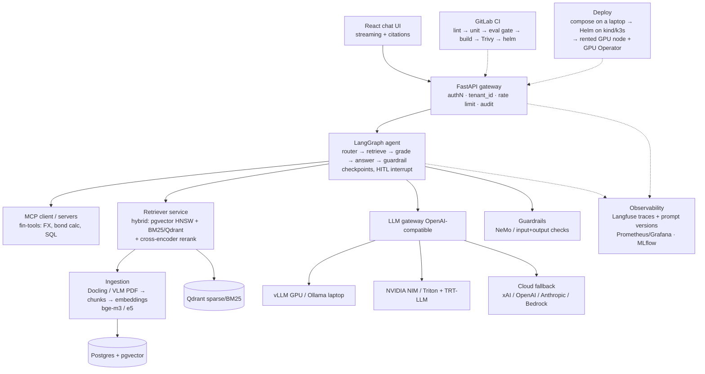

# agentic-rag-platform

On-prem-capable **agentic RAG** reference platform: a FastAPI gateway in front
of a LangGraph agent, MCP tools, hybrid retrieval (pgvector + Qdrant +
reranker), local inference (vLLM / NVIDIA NIM), Langfuse tracing, evals in CI,
and a Helm chart.

This repo is the portfolio project for a Senior AI Platform Engineer
(Generative & Agentic AI) role. The rule is simple: **claim only what you can
demo**. The 20-day roadmap below is the build plan; Day 1 is what runs today.

Default LLM provider is **xAI Grok** via the official [`xai-sdk`](https://pypi.org/project/xai-sdk/)
(`grok-4.7`). OpenAI and Anthropic adapters are included so their tool-calling
and structured-output APIs can be learned and compared — see
[docs/learning-notes.md](docs/learning-notes.md).

## What works today (Day 1)

- FastAPI app with `GET /health` and `POST /chat`
- Provider interface (`Protocol`) with **xAI as default**, plus OpenAI and
  Anthropic official-SDK adapters, selected by `LLM_PROVIDER`
- Tool-calling loop with a `get_fx_rate(base, quote)` tool (NBP API, Frankfurter
  fallback, timeouts, structured errors)
- Structured output `Answer{answer, citations, confidence}` validated with Pydantic
- Settings via `pydantic-settings`, `.env` / `.env.example`
- `docker-compose` (api + Postgres/pgvector; Langfuse stub commented for Day 6)
- Multi-stage, non-root `Dockerfile` built with `uv`
- pre-commit (ruff, mypy), pytest, GitHub Actions CI (no real API calls)
- `make smoke` — optional live call to xAI when `XAI_API_KEY` is set

## Planned architecture



Day 1 is the **LLM gateway** slice: provider adapters, the tool loop, and the
HTTP API. Retrieval, MCP, tracing, evals, local inference and Kubernetes land
on later days.

## Quickstart

Requirements: Python 3.12 and [uv](https://docs.astral.sh/uv/). An
[xAI API key](https://console.x.ai/) for live calls.

```bash
git clone https://github.com/saequus/agentic-rag-platform.git
cd agentic-rag-platform
uv sync --dev
cp .env.example .env
# edit .env and set XAI_API_KEY=...

uv run fastapi dev src/agentic_rag_platform/main.py --port 8000
```

Health check and a chat turn:

```bash
curl -s http://127.0.0.1:8000/health | jq

curl -s http://127.0.0.1:8000/chat \
  -H 'content-type: application/json' \
  -d '{"message":"What is the mid rate of 1 USD in PLN today? Cite your source."}' | jq
```

Example response shape:

```json
{
  "answer": "1 USD is 4.25 PLN at the NBP mid rate published on 2026-11-19.",
  "citations": ["https://api.nbp.pl/api/exchangerates/rates/a/usd/?format=json"],
  "confidence": 0.93,
  "provider": "xai",
  "model": "grok-4.7",
  "tool_calls": [
    {
      "id": "call_1",
      "name": "get_fx_rate",
      "arguments": {"base": "USD", "quote": "PLN"},
      "result": "{\"base\": \"USD\", \"quote\": \"PLN\", \"rate\": 4.25, \"source\": \"NBP\"}"
    }
  ]
}
```

### Docker Compose

```bash
cp .env.example .env   # set XAI_API_KEY
docker compose up --build
curl -s http://127.0.0.1:8000/health
```

Postgres with pgvector is started for Day 2 ingestion. The Day 1 API does not
query it yet. A Langfuse service is left commented in `docker-compose.yml`.

### Tests and live smoke

```bash
make lint          # ruff + mypy
make test          # unit tests, all HTTP/LLM calls mocked
make smoke         # real xAI call; requires XAI_API_KEY; not run in CI
```

CI on `main` and on pull requests runs ruff, mypy and pytest only. No secrets
are required and no provider APIs are contacted.

## Switching providers

```bash
# default
LLM_PROVIDER=xai
XAI_API_KEY=...
XAI_MODEL=grok-4.7          # optional; this is the default
XAI_BASE_URL=https://api.x.ai/v1

# alternatives, for learning their APIs
LLM_PROVIDER=openai         OPENAI_API_KEY=...     OPENAI_MODEL=gpt-4o
LLM_PROVIDER=anthropic      ANTHROPIC_API_KEY=...  ANTHROPIC_MODEL=claude-sonnet-5
```

`XAI_BASE_URL` is the documented OpenAI-compatible REST base
(`https://api.x.ai/v1`). The official SDK used by `XAIProvider` talks gRPC to
`api.x.ai`. See the [quickstart](https://docs.x.ai/developers/quickstart).

## Repository layout

```
src/agentic_rag_platform/
  main.py                 FastAPI app: /health, /chat
  settings.py             pydantic-settings
  schemas.py              Answer, ChatRequest, Message, ToolCall
  providers/              xAI (default), OpenAI, Anthropic + factory
  tools/                  get_fx_rate + registry
  agent/loop.py           tool loop + structured final answer
tests/                    mocked unit tests
scripts/smoke.py          optional live xAI check
docs/learning-notes.md    vendor API comparison with doc links
```

## Roadmap (20 weekdays, 19 Nov – 16 Dec 2026)

- [x] **Day 1** — LLM gateway, provider interface, tool calling, structured output, CI
- [ ] **Day 2** — Ingestion, chunking, embeddings, pgvector
- [ ] **Day 3** — Hybrid search, Qdrant, reranking
- [ ] **Day 4** — LangGraph agents (LangChain / LlamaIndex / Pydantic AI trade-offs)
- [ ] **Day 5** — MCP server and client
- [ ] **Day 6** — Observability: Langfuse, prompt versioning, OpenTelemetry
- [ ] **Day 7** — Evals: Ragas, DeepEval, golden set, eval gate in CI
- [ ] **Day 8** — vLLM and Ollama local inference
- [ ] **Day 9** — SLMs, quantization, PEFT/LoRA basics
- [ ] **Day 10** — NVIDIA stack I: GPUs, CUDA, TensorRT-LLM, Triton, NIM
- [ ] **Day 11** — NVIDIA stack II: NeMo Guardrails, AI Enterprise, Blueprints
- [ ] **Day 12** — VLMs and multimodal document parsing
- [ ] **Day 13** — Kubernetes for AI: Helm, GPU scheduling, autoscaling
- [ ] **Day 14** — CI/CD and LLMOps with GitLab CI (and Jenkins)
- [ ] **Day 15** — AI security: prompt injection, OWASP LLM Top 10, access control
- [ ] **Day 16** — Hybrid cloud / on-prem: Bedrock, Vertex, Azure, Terraform, React UI
- [ ] **Day 17** — Documentation, system diagrams, solution design, RFP/RFI
- [ ] **Days 18–20** — Mock interviews (HR, system design, pre-sales)

## License

MIT. See [LICENSE](LICENSE).
